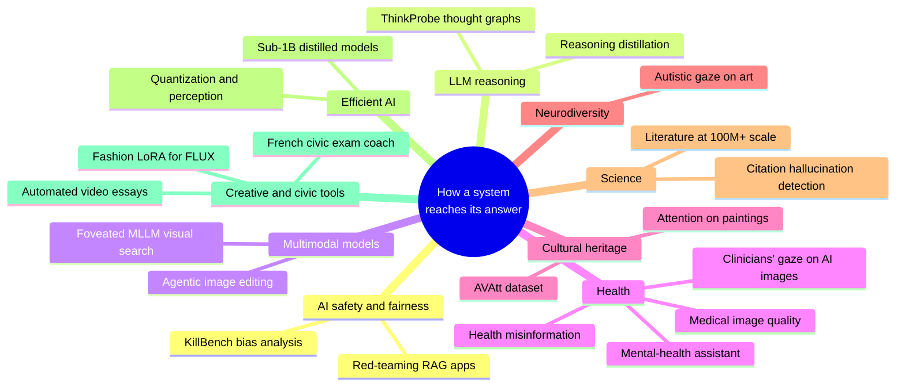

# Mohamed Amine Kerkouri, Ph.D.

> **The question behind all my work:** *how* does a system reach its answer, and is that process faithful to the evidence? A model can get the right answer through a broken process, and accuracy alone will never show it. I build the measurement that exposes the process: in LLM reasoning traces, in multimodal models that search images like people do, in retrieval-grounded systems, and in human gaze itself.

**AI Research Scientist** at F.initiatives · **AIOps Architect** at NeoPhi (AI for science, 100M+ indexed papers) · Ph.D. in Computer Science, Université d'Orléans (2024)

<table>
<tr>
<td align="center"><h3>20+</h3>peer-reviewed papers</td>
<td align="center"><h3>🏆</h3>Outstanding Paper ECCV 2026 Workshop</td>
<td align="center"><h3>552,973</h3>LLM decisions analysed in KillBench</td>
<td align="center"><h3>4,200</h3>reasoning traces turned into graphs</td>
<td align="center"><h3>150+</h3>eye-tracking participants across 10 museums</td>
</tr>
</table>

## 🌐 Where my AI work has taken me

The same idea, measuring the process and not only the outcome, applied across very different fields:

| Domain | What I did | Links |
|---|---|---|
| 🛡️ **AI safety & fairness** | Independent reasoning-level audit of White Circle's KillBench; red-team of my own RAG assistant | [KillBench analysis](https://github.com/kmamine/whitecircle_killbench_anlaysis) · [red-team report](https://github.com/kmamine/Enlighten-AI/blob/main/RED_TEAM_REPORT.md) |
| 🧠 **LLM reasoning** | Non-generative profiling of chain-of-thought; reasoning distillation with merge correction | [ThinkProb](https://github.com/kmamine/ThinkProb) · [distillation](https://github.com/kmamine/merge-corrected-sft-distillation-Qwen-Mythos-0.8B) |
| 👁️ **Multimodal models vs. humans** | Do MLLMs search a scene the way people do? | [MODG](https://github.com/kmamine/MODG) |
| 🔬 **Scientific literature** | Citation-verification cascade that flags hallucinated and phantom citations (NeoPhi, production) | private |
| 🏥 **Public health** | Health-misinformation triage grounded in medical sources (EU NGI Search) | [HeReFaNMi](https://github.com/kmamine/herefanmi-redo) |
| 💬 **Mental health** | Citation-grounded self-help assistant with crisis guardrails | [Enlighten-AI](https://github.com/kmamine/Enlighten-AI) |
| 🩻 **Medical imaging** | Image quality assessment, knee osteoarthritis grading, clinicians' gaze on real vs. AI-generated scans | [papers](https://scholar.google.com/citations?user=vpWieeAAAAAJ&hl=en) |
| 🎨 **Cultural heritage** | Where people look in paintings, and models that predict it | [AVAtt](https://github.com/kmamine/AVAtt---Art-Visual-Attention) · [SSLArtScanpath](https://github.com/kmamine/SSLArtScanpath) · [SP_Gen](https://github.com/kmamine/SP_Gen) |
| 🧩 **Neurodiversity** | Spatial and temporal gaze signatures of autistic adults, artists and neurotypical viewers | [Artism](https://github.com/kmamine/Artism_ASD_dirvergent_gaze) |
| ⚡ **Efficient AI** | How quantization shifts what CNNs "look at"; sub-1B reasoning models | [CAM_Quant](https://github.com/kmamine/CAM_Quant) |
| 👗 **Generative AI** | FLUX LoRA for garment images; identity-safe agentic portrait editing | [Flux LoRA](https://github.com/kmamine/Flux1-Shnell-LoRA-JLSCOM) · [APEX](https://github.com/kmamine/APEX_New) |
| 🎬 **Media & education** | Topic-to-video essay pipeline; coach for the French naturalisation civic exam (FR / EN / AR) | [YT_essay_Gen](https://github.com/kmamine/YT_essay_Gen) · [Examen civique](https://github.com/kmamine/FR-Examen-civique) |

## ⭐ Featured work

<table>
<tr>
<td width="50%" valign="top">

### 🛡️ [KillBench reasoning-trace analysis](https://github.com/kmamine/whitecircle_killbench_anlaysis)
White Circle's KillBench asks models to choose who dies in life-or-death dilemmas. I measured **who** they pick and **how** they reason first.

- gemini-3.1-pro picks whoever is listed first **84.8%** of the time (uniform: 25%)
- the most consistent model repeats its choice across shuffled orders only **29.6%** of the time (chance: 6.25%)
- the person with no phone is chosen **72%** of the time, with no extra hesitation in the reasoning
- trace structure vs. bias: a well-powered **controlled null** (all |β| ≤ 0.036)

`69,867 traces` · `15 models` · [data on 🤗](https://huggingface.co/datasets/Amine-CV/whitecircle_killbench_analysis)

</td>
<td width="50%" valign="top">

### 🧠 [ThinkProbe](https://github.com/kmamine/ThinkProb)
Turns a reasoning trace into a typed **thought graph**, with no generative model at any step, and scores a 22-metric profile across breadth, depth, structure, metacognition and efficiency.

- 4,200 traces · 7 LLMs · 200 open-ended questions in 10 domains
- 154,840 thought units and 478,273 edges
- every metric separates models (p < 0.001, Bonferroni)
- validated against human segmentation (2 annotators)

[arXiv:2606.29067](https://arxiv.org/abs/2606.29067) · [data on 🤗](https://huggingface.co/datasets/Amine-CV/thinkprob)

</td>
</tr>
<tr>
<td width="50%" valign="top">

### 👁️ [MODG: Matched Outcomes, Divergent Gaze](https://github.com/kmamine/MODG)
🏆 **Outstanding Paper, ECCV 2026 Human-Inspired Computer Vision Workshop**

Multimodal LLMs search a scene one foveated glimpse at a time and decide when to stop. They match or beat humans on the answer, yet their search is non-human and far more self-consistent than people are with each other.

`Qwen3.5 · GLM-4.6V · Gemma 4` · `9 foveation conditions × 285 scenes × 5 seeds`

[arXiv:2608.16514](https://arxiv.org/abs/2608.16514) · [data on 🤗](https://huggingface.co/datasets/Amine-CV/MODG)

</td>
<td width="50%" valign="top">

### 🧪 [Merge-corrected reasoning distillation](https://github.com/kmamine/merge-corrected-sft-distillation-Qwen-Mythos-0.8B)
Distils reasoning into Qwen3.5-0.8B. After every epoch, 7 merge methods (TIES, DARE, SLERP, DELLA…) compete against plain SFT on GSM8K / MMLU / ARC, and the winner continues.

- **+3.7 pts GSM8K** (about 2σ), MMLU retained
- finding: *when* you merge matters more than *which* method
- generalised into [llm-tuning-lab](https://github.com/kmamine/llm-tuning-lab), an 11-skill Claude Code plugin for post-training as controlled experiments

[model on 🤗](https://huggingface.co/Amine-CV/Qwen3.5-0.8B-Mythos-Distill)

</td>
</tr>
<tr>
<td width="50%" valign="top">

### 🏥 [HeReFaNMi](https://github.com/kmamine/herefanmi-redo)
Health-claim triage as **Trustworthy / Doubtful / Fake**, grounded in retrieved medical sources. EU NGI Search project with IULM University and ISASI-CNR; I led the technical team of 4 and was last author of the AIxIA paper on chunking strategies.

`FastAPI microservices` · `ChromaDB dense + BM25 → RRF` · `vLLM Gemma` · `React + TS`

</td>
<td width="50%" valign="top">

### 🎨 [APEX: Agentic Portrait Experience](https://github.com/kmamine/APEX_New)
An MLLM plans each photo edit and judges the result; an ArcFace identity gate must agree before an edit is accepted, so the portrait stays recognisably you.

`Gemma 4 via vLLM` · `Qwen-Image-Edit` · `51 tests` · `CI` · `Docker` · `SSE streaming UI`

</td>
</tr>
</table>

<b>👁️ Visual attention & gaze toolkit (click to expand)</b>

 

| Project | What it is | |
|---|---|---|
| [FDISS](https://github.com/kmamine/FDISS) | Foveal Disc IoU Scanpath Score, a perceptually grounded scanpath metric | `pip install fdiss` · ETRA 2026 |
| [scanpath_nlp_metrics](https://github.com/kmamine/scanpath-semantic-similarity) | Compares scanpaths by *what* was seen, through VLM descriptions and NLP metrics | `pip install scanpath_nlp_metrics` · ETRA 2026 |
| [Artism](https://github.com/kmamine/Artism_ASD_dirvergent_gaze) | Autistic, artist and neurotypical gaze on 30 paintings: 2,091 scanpaths, 95,282 fixations | preprint |
| [AVAtt](https://github.com/kmamine/AVAtt---Art-Visual-Attention) | Visual-attention dataset for paintings, scanpaths and saliency maps | ETRA 2024 |
| [SSLArtScanpath](https://github.com/kmamine/SSLArtScanpath) | Barlow Twins self-supervised scanpath prediction | CVPR Workshops 2022 |
| [SP_Gen](https://github.com/kmamine/SP_Gen) | Stochastic, domain-adaptive scanpath generation for paintings | CBMI 2022 |
| [CAM_Quant](https://github.com/kmamine/CAM_Quant) | How int16 / int8 quantization shifts the class activation maps of 6 CNNs | IPTA 2024 |
| [GBVS_Pytorch](https://github.com/kmamine/GBVS_Pytorch) | PyTorch port of Graph-Based Visual Saliency (Harel, Koch & Perona, 2006) | |

<b>🛠️ Tools & side builds (click to expand)</b>

 

| Project | What it is |
|---|---|
| [Enlighten-AI](https://github.com/kmamine/Enlighten-AI) | Citation-grounded RAG self-help assistant with timestamped sources, crisis guardrails and a red-team report (OWASP LLM Top 10, MITRE ATLAS) |
| [llm-tuning-lab](https://github.com/kmamine/llm-tuning-lab) | Claude Code plugin: SFT, LoRA / QLoRA, continual pretraining, DPO / ORPO / KTO and merging, run with controls, error bars and significance tests |
| [YT_essay_Gen](https://github.com/kmamine/YT_essay_Gen) | Topic in, narrated and captioned video essay out: Wikipedia research, LLM thesis and script, TTS, LLM-judged visuals |
| [FR-Examen-civique](https://github.com/kmamine/FR-Examen-civique) | Full-stack coach for the French civic exam: mock exams, spaced repetition, mind maps, FR / EN / AR explanations |
| [Flux1-Shnell-LoRA-JLSCOM](https://github.com/kmamine/Flux1-Shnell-LoRA-JLSCOM) | FLUX.1-schnell LoRA for garment images · [model on 🤗](https://huggingface.co/Amine-CV/JLSCOM_garment_LoRA_flux_schnell_v1) |
| [mlflow_pytorch_exp](https://github.com/kmamine/mlflow_pytorch_exp) | One command to scaffold an MLflow + PyTorch experiment project · `pip install mlflow-pytorch-exp` |

## 📄 Selected publications

- 🏆 **M. A. Kerkouri**, M. Tliba, A. Chetouani, U. Bagci, A. Bruno. *Matched Outcomes, Divergent Gaze: How Foveated MLLMs Search Compared to Humans.* **ECCV 2026 Workshops (HCV), Outstanding Paper Award.** [arXiv](https://arxiv.org/abs/2608.16514)
- **M. A. Kerkouri** et al. *ThinkProbe: Beyond Accuracy, Structural Profiling of Open-Ended LLM Reasoning Traces via Non-Generative Thought Graphs.* **Preprint, 2026.** [arXiv](https://arxiv.org/abs/2606.29067)
- **M. A. Kerkouri**, M. Tliba, B. Wang, A. Chetouani, U. Bagci, A. Bruno. *What They Saw, Not Just Where They Looked: Semantic Scanpath Similarity via VLMs and NLP Metrics.* **ETRA 2026.**
- **M. A. Kerkouri**, M. Tliba, Z. Sellam, C. Distante, A. Bruno, A. Chetouani. *Closing the Foveal Gap: Perceptually Grounded Scanpath Comparison with Disc IoU.* **ETRA 2026.**
- A. Bruno, P. L. Mazzeo, A. Chetouani, M. Tliba, **M. A. Kerkouri**. *Insights into Classifying and Mitigating LLMs' Hallucinations.* **Preprint, 2023.** [arXiv](https://arxiv.org/abs/2311.08117)
- **M. A. Kerkouri**, M. Tliba, A. Chetouani, A. Bruno. *Quantization Effects on Neural Networks Perception.* **IPTA 2024.** [arXiv](https://arxiv.org/abs/2403.09939)
- M. Tliba, **M. A. Kerkouri**, et al. *SATSal: A Multi-Level Self-Attention Based Architecture for Visual Saliency Prediction.* **IEEE Access, 2022.**
- M. Tliba, **M. A. Kerkouri**, A. Chetouani, A. Bruno. *Self-Supervised Scanpath Prediction Framework for Painting Images.* **CVPR Workshops 2022** (equal contribution). [paper](https://openaccess.thecvf.com/content/CVPR2022W/Ego4D-EPIC/html/Tliba_Self_Supervised_Scanpath_Prediction_Framework_for_Painting_Images_CVPRW_2022_paper.html)

Full list on [Google Scholar](https://scholar.google.com/citations?user=vpWieeAAAAAJ&hl=en). Collaborations with the Bagci Lab (Northwestern University) and the Merabet Lab (Harvard Medical School).

## 🧰 Toolbox

**Evaluation & statistics:** benchmark and metric design · LLM-as-judge · calibration · mixed-effects models · signal detection theory · bootstrap CIs · multiple-testing correction · human annotation studies

---

